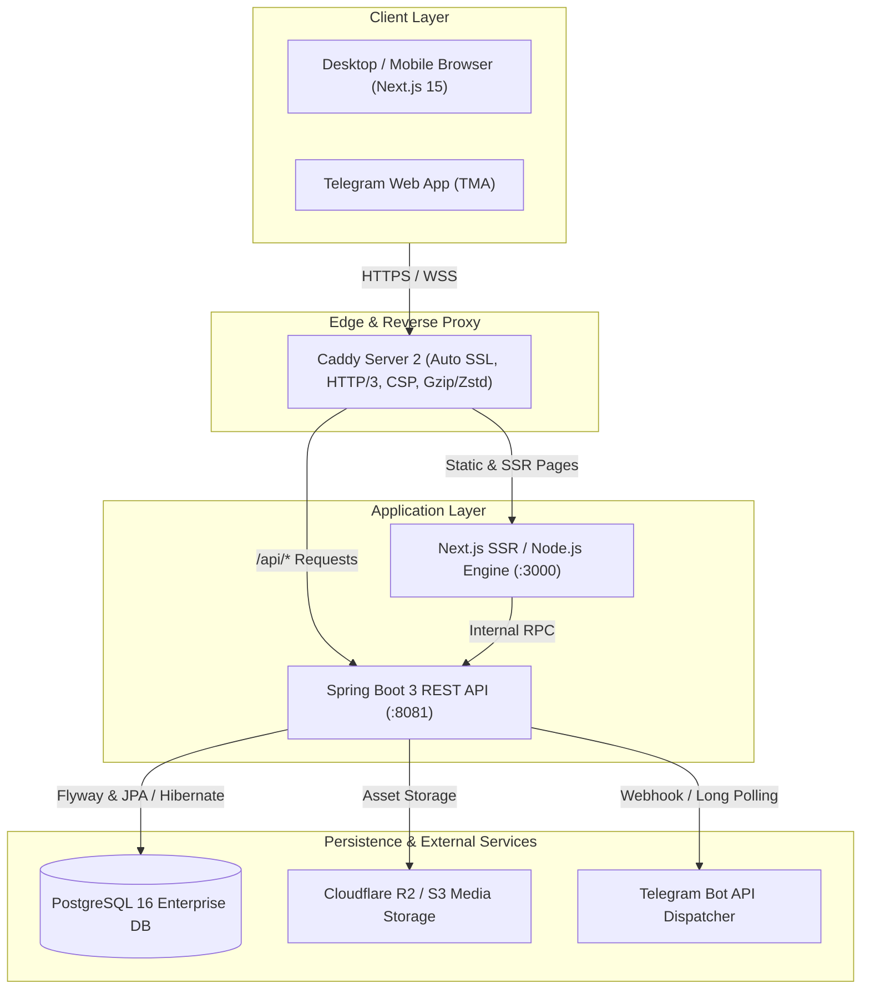

<div align="center">

  # 🎂 MO'JIZA 777
  ### Premium Artisan Bakery & Luxury Confectionery E-Commerce Platform

  [](https://www.oracle.com/java/)
  [](https://spring.io/projects/spring-boot)
  [-black?style=for-the-badge&logo=next.js&logoColor=white)](https://nextjs.org/)
  [](https://www.typescriptlang.org/)
  [](https://www.postgresql.org/)
  [](https://www.docker.com/)
  [](https://tailwindcss.com/)
  [](https://github.com/radjaboff/mujiza777/actions)

  <p align="center">
    <strong>A high-performance, full-stack enterprise web application built for the premier confectionery brand "Mo'jiza 777" in Qarshi, Uzbekistan.</strong>
    <br />
    Featuring modern headless architecture, real-time custom cake construction, telegram bot dispatch, strict financial precision, and bank-grade security.
  </p>

  <p align="center">
    <a href="#-key-features">Key Features</a> •
    <a href="#-system-architecture">Architecture</a> •
    <a href="#-tech-stack">Tech Stack</a> •
    <a href="#-getting-started">Getting Started</a> •
    <a href="#-security--reliability">Security</a> •
    <a href="#-api--admin-showcase">Admin Showcase</a>
  </p>

</div>

---

## 🌟 Key Features

### 🛒 Customer Experience & Storefront
* **🎨 Interactive Custom Cake Builder:** Real-time multi-step cake visualizer allowing customers to select tiers, sponge bases, artisan fillings, exterior coatings, custom inscriptions, and decorative accessories with instantaneous dynamic pricing.
* **⚡ High-Speed Headless Catalog:** Server-rendered Next.js 15 catalog with instant category filtering, real-time debounced search, dietary/allergen tagging (`NUTS`, `GLUTEN`, `DAIRY`, `HALAL`), and browser history popstate synchronization.
* **🛍️ Resilient Cart & Instant Checkout:** Client-side persisted cart with mathematical precision checks, automated discount vouchers, promotional banners, delivery time-slot reservations, and anonymous gift ordering.
* **🌐 Native Internationalization (i18n):** Full localized multi-language support (Uzbek `uz` and Russian `ru`) with SEO-optimized dynamic metadata and canonical alternates.
* **📱 Progressive Web App (PWA) & Mobile First:** Fluid responsive design, touch-optimized swipeable stories, haptic audio feedback, and seamless Telegram Mini-App (TMA) integration.

### 👑 Enterprise Admin Control Center
* **📊 Business Intelligence & Analytics:** Live revenue metrics, average order value (AOV), daily visit counters, top-selling pastry analytics, and downloadable Excel financial audits.
* **📦 Complete Catalog & Stock Management:** Dynamic control of products, categories, pricing, seasonal discounts with automated countdown timers, and unit controls (pieces vs. kg).
* **🚚 Smart Delivery & Logistics Dispatch:** Delivery slot management, branch-specific pickup schedules, radius calculation, and operational store hours toggling.
* **👥 Staff RBAC & Audit Trails:** Role-Based Access Control (`ADMIN`, `OPERATOR`, `COURIER`) with tamper-proof security audit logging tracking all administrative mutations.
* **🥂 VIP Event & Catering Inquiries:** Dedicated lead management funnel for wedding banquets, corporate dessert bars, and bespoke catering celebrations.

### 🤖 Automation & Notifications
* **📲 Telegram Bot Integration:** Instant push notifications dispatched to managers upon order placement with inline keyboard status progression (`ACCEPT`, `COOKING`, `READY`, `DELIVERED`).
* **🔄 Daily Automated Reports:** Scheduled cron service compiling nightly sales reconciliations and order completion metrics sent directly to store leadership.

---

## 🏗️ System Architecture

The project adheres to a clean separation of concerns between client rendering, edge gateway, and transactional backend services.



---

## 💻 Tech Stack

| Domain | Technology | Description |
| :--- | :--- | :--- |
| **Frontend Framework** | **Next.js 15.5 (App Router)** | Server Components, Streaming SSR, and Static Site Generation |
| **Language** | **TypeScript 5.x** | Strict mode typing across all views, stores, and API clients |
| **Styling** | **Tailwind CSS 3.4** | Custom luxury palette (Emerald Green `#244B2B` & Artisan Gold `#D4AF37`) |
| **State Management** | **Zustand + LocalStorage** | Ultra-lightweight persistent client stores for Cart and Favorites |
| **Backend Framework**| **Spring Boot 3.3.x** | High-throughput Java enterprise REST platform |
| **Security & Auth** | **Spring Security 6 + JWT** | Stateless token auth with `HttpOnly`, `SameSite=Strict`, `Secure` cookies |
| **Database** | **PostgreSQL 16 + Flyway** | Relational ACID store with 24 automated evolutionary migration scripts |
| **Connection Pool** | **HikariCP** | High-performance JDBC connection pooling with leak detection |
| **Proxy & Gateway** | **Caddy 2** | Production reverse proxy with automated Let's Encrypt TLS and HTTP/3 |
| **DevOps & CI/CD** | **Docker & GitHub Actions** | Containerized builds and automated multi-step CI test runners |

---

## 🛡️ Security & Reliability Engineering

* **Financial & Arithmetic Overflow Guard:** All monetary totals utilize Java `Math.addExact()` and strict range constraints (`@Max`) to eliminate integer overflow risks. Client pricing logic strictly computes integer mill-cents to prevent JavaScript IEEE-754 floating-point inaccuracies.
* **Hardened Content Security Policy (CSP):** Rigorous CSP headers with zero `'unsafe-eval'` directives, restricting image, frame, and connect origins solely to required domain endpoints (Telegram API, Yandex Maps, Unsplash).
* **Idempotent Order Creation:** Order submissions require client-generated UUID idempotency keys, eliminating duplicate credit charges or repeated orders from accidental double-clicks or unstable mobile connections.
* **Database Disaster Recovery:** Hardened zero-data-loss backup and restore automation (`restore-db.sh`) configured with PostgreSQL `--exit-on-error` validation to guarantee rollback consistency.
* **Tamper-Proof Audit Logging:** Critical actions (price modifications, permission grants, and state overrides) are immutably archived with admin IP addresses, usernames, and timestamp vectors.

---

## 🚀 Getting Started

### Prerequisites
* **Java:** OpenJDK 17 or higher
* **Node.js:** v20.x or v22.x LTS (with `npm`)
* **Database:** PostgreSQL 16
* **Docker:** Docker Desktop or Docker Engine with Docker Compose (v2.x)

### 1. Clone the Repository
```bash
git clone https://github.com/radjaboff/mujiza777.git
cd mujiza777
```

### 2. Configure Environment Variables
Create your local environment file from the pre-configured template:
```bash
cp .env.example .env
```
*(All production secrets and database passwords in `.env` are automatically ignored by `.gitignore`)*.

---

### 3. Run with Docker Compose (Recommended)
Launch the entire containerized stack with a single command:
```bash
docker compose up -d --build
```
The application will be live at:
* **Web Storefront:** `http://localhost:3000`
* **Backend REST API:** `http://localhost:8081/api`
* **API Documentation:** `http://localhost:8081/swagger-ui.html`

---

### 4. Manual Local Development

#### Backend (Spring Boot):
```bash
# Run database migrations and start backend
./mvnw spring-boot:run
```

#### Frontend (Next.js):
```bash
cd frontend
npm install
npm run dev
```
Open [http://localhost:3000/uz](http://localhost:3000/uz) in your browser.

---

## 🧪 Testing & Quality Assurance

The codebase maintains rigorous quality gates verified via automated workflows:

```bash
# Run Frontend Linting (0 warnings, 0 errors)
cd frontend && npm run lint

# Run Frontend Type-Check
npx tsc --noEmit

# Run Backend Unit & Integration Tests (78+ test suites)
./mvnw test
```

---

## 📂 Project Directory Structure

```text
mujiza777/
├── .github/workflows/       # GitHub Actions automated CI pipelines
├── docker/                  # PostgreSQL initialization & container configurations
├── docs/                    # Technical specifications, architecture docs & manuals
├── frontend/                # Next.js 15 Client Application
│   ├── messages/            # i18n localization dictionaries (uz.json, ru.json)
│   ├── public/              # Optimized static media & original brand vector favicons
│   ├── src/
│   │   ├── app/             # Next.js App Router ([lang] routes & admin views)
│   │   ├── components/      # Modular React UI components (CakeBuilder, Catalog, etc.)
│   │   ├── lib/             # API client, pricing math engine, audio & formatters
│   │   └── stores/          # Lightweight Zustand state containers
├── scripts/                 # Automated database backup and restore shell scripts
├── src/                     # Spring Boot 3 Backend Application
│   ├── main/java/uz/akmal/mujiza/
│   │   ├── admin/           # Administrative security & staff management
│   │   ├── cake/            # Custom 3D cake builder catalog & pricing services
│   │   ├── catalog/         # Product, category, allergen & discount domain
│   │   ├── catering/        # VIP banquet event inquiries & leads
│   │   ├── common/          # Rate limiters, global exception handlers & slug utils
│   │   ├── notification/    # Telegram bot webhook, updates & daily reporting
│   │   ├── order/           # Order state machine, cart calculation & checkout
│   │   └── security/        # JWT filter, authentication providers & CORS filters
│   └── main/resources/
│       ├── db/migration/    # 24 Flyway versioned SQL migrations
│       └── application.properties
├── Caddyfile                # Production TLS edge proxy configuration
├── docker-compose.yml       # Production multi-service orchestration
└── pom.xml                  # Maven dependencies & build lifecycle
```

---

## 📄 License & Attribution

Developed with craftsmanship by **[Akmal Rajabov](https://github.com/radjaboff)**.  
All brand emblems, visual design assets, and pastry trade names are property of **"Mo'jiza 777" Confectionery House**.

<div align="center">
  <sub>Built with passion, precision, and modern software engineering principles.</sub>
</div>
